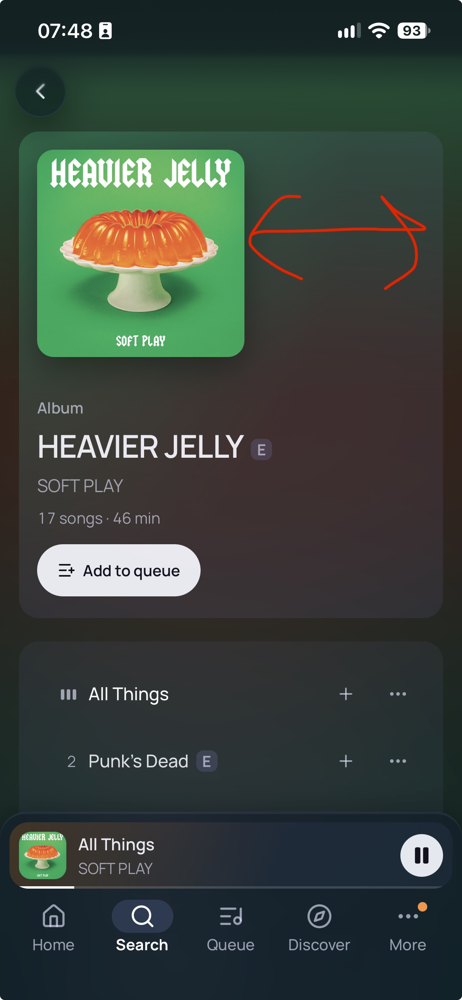
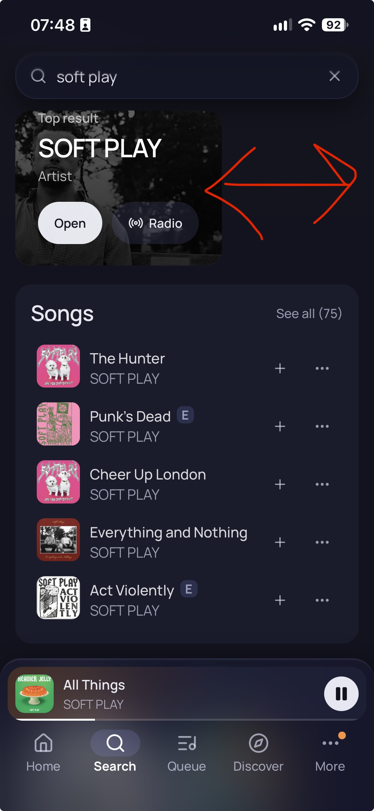
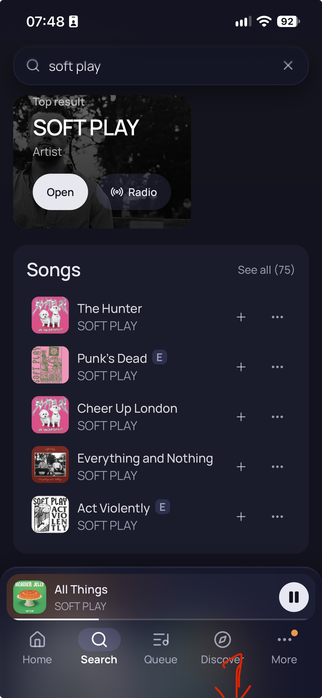
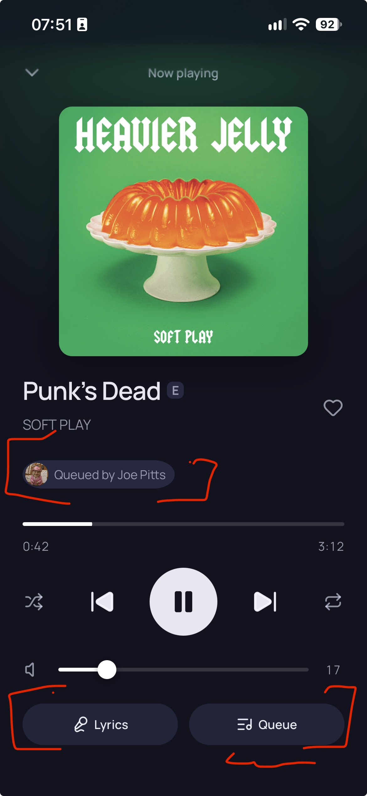
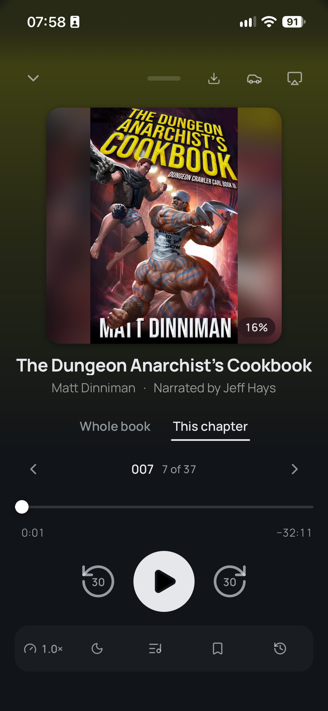
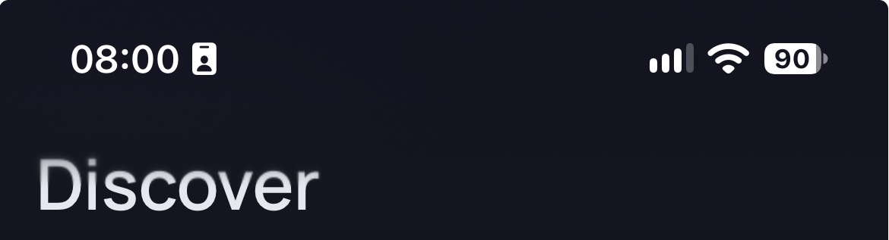
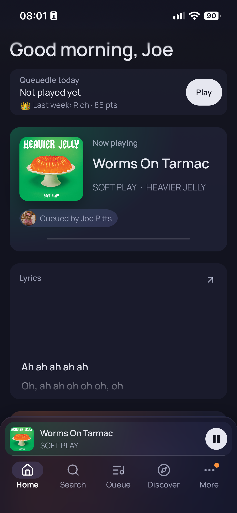
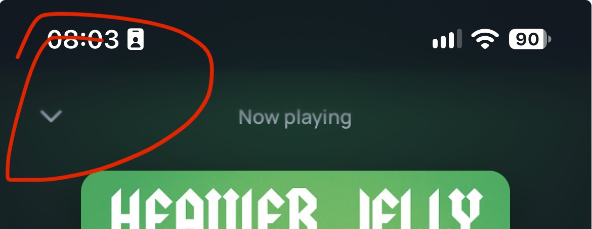

# Owner's feedback from a real iPhone 14

The owner tried the shipped phone shell on his own iPhone 14 on 13 November and sent annotated screenshots. Each
item below has his words (quoted exactly), the screenshot, the coordinator's reading of it (marked as such: it is
an interpretation, not his words), and the brief that owns the fix. **If your letter is on an item, it is part of
your brief and comes before the brief's own list.** Look at the screenshot itself, not just the description.

What he confirmed works on the real phone:

- Long-press opens the row menu.
- "A lot is working, the issues I see are mostly styling."
- In his screenshots the tab bar and mini player read as solid frosted bars, with real blur and normal font
  weight: the thin type and missing blur seen in Playwright's WebKit on Windows are that build's quirks.

---

## 1. Album hero: art is left-aligned, and the text block is "liney" — brief E

> Left aligned album art on mobile makes no sense, should be full bleed. Also the description is very "liney"

**What the screenshot shows.** `/album/:id` in Safari. The hero is `common/HeroBand` (also used by Playlist). The
art is a square about half the card's width, pinned left, with empty card to its right (his red arrows span that
gap). Under it sit five separate lines with wide gaps between them: "Album", the title with its explicit badge,
the artist, "17 songs · 46 min", then the Add to queue pill.

**Coordinator's reading.**

- *Full bleed*: on the phone the artwork should run the full width, edge to edge, not sit as a half-width
  thumbnail inside a padded card. Whether that means the full width of the screen (art to the screen edges and up
  under the top strip, the title block below it) or the full width of the card is a design call for the agent to
  make and show; the first is the stronger reading of "full bleed". The Back button then sits over the art, on a
  scrim or the dense material, so it stays legible on a pale cover. DESIGN.md's rules still hold: imagery clipped
  with `object-fit: cover`, white text only over a scrim, the hero-art shadow only if the art is still a print on
  a surface.
- *Liney*: the meta reads as a stack of unrelated lines. Set it as one block with a clear hierarchy and tighter
  rhythm: the title as the feature line (two lines before it truncates, the explicit badge inline), then one
  secondary line that carries the rest ("SOFT PLAY · Album · 17 songs · 46 min", the artist still a link with a
  44px hit area), then the action. The small "Album" label above the title is the first thing to fold in. The
  44px tap targets are for hit areas, not for line spacing: pad the hit area without pushing the lines apart.
- Apply the same treatment to the Playlist hero (same component), and check an album with a long title, a
  playlist with generated art, and a playlist the user owns (its title is click-to-edit).

**Ownership.** `common/HeroBand.tsx` and `HeroBand.module.css` move to brief E for this (brief A leaves them
alone). The desktop layout must not change: scope it to the phone shell.

---

## 2. Search: the top result card is half width — brief E

> On search results this top card is half width, should be full

**What the screenshot shows.** `/search` in Safari, query "soft play". The Top result card
(`common/TopResultCard`) is about 255px wide and 190px tall, pinned left, with empty page to its right (his red
arrows span that gap). The Songs card under it is full width. The "Top result" label also sits hard against the
card's top edge, tighter than the card's other padding.

**Coordinator's reading.**

- The card should span the full width of the page, like the Songs card under it.
- This is very likely a **Safari-only layout bug**, not a design choice: in Chromium the same card is full width
  (the journey's screenshots show it so). `TopResultCard.module.css` gives the stacked card `aspect-ratio: 4 / 3`
  with `max-height: 22em`; 255x190 is exactly 4:3, which suggests WebKit clamps the height and then derives the
  width from it. The base branch already fixed the same thing in `ArtCard.module.css` ("WebKit sizes a stretched
  grid item with an aspect ratio from its (empty) height") with an explicit `width: 100%`. Treat that as a lead to
  confirm in WebKit (`--device "iPhone 14"`), not as the answer.
- Then **look for the same pattern everywhere else**: any element on a phone page that combines `aspect-ratio`
  with a `max-height`, `max-width` or a stretched grid or flex cell. Home's pick cards, image tiles, heroes and
  the Now playing art are the candidates. Chromium will not show it; only WebKit will.
- Fix the label's top padding while there: it should sit on the card's normal inset, on the top scrim.
- Check it with an artist (photo), an album or song (cover), and a result with no art (the Lit Wall fallback).

**Ownership.** `common/TopResultCard.tsx` and `TopResultCard.module.css` move to brief E (brief A leaves them
alone). If the same bug turns up in a component another brief owns, report it with the WebKit screenshot rather
than fixing it. Scope the change to the phone shell.

---

## 3. The dock leaves a lot of empty space at the bottom — brief A

> We leave a lot of space on the table at the bottom

**What the screenshot shows.** The same Search page; his red arrow points down from the "Discover" tab label to
the bottom edge of the screen. Under the tab labels there is about 40px of empty bar before the screen ends.
Scaling from the image (924px wide for 390 CSS px): the dock as a whole (mini player, tab bar and the space under
it) takes roughly 156px of the 844px screen, nearly a fifth.

**Where it comes from.** `PhoneShell.module.css` pads the dock with `padding: 8px 8px var(--safe-bottom)`, and
`global.css` sets `--dock-h: 124px` ("8px gap + 56px mini player + 4px + 56px tab bar"). On this phone the bottom
safe area is the full 34px home-indicator inset, so the space under the labels is that 34px plus the tab bar's own
slack under its label.

**Coordinator's reading.**

- The full 34px inset is conservative. The home indicator itself is a thin bar a few pixels tall sitting about 8px
  above the bottom edge; nothing needs to stay clear of the whole 34px, only of the indicator. Let the tab row sit
  lower: pad the bottom by the inset minus about 12 to 14px (and never less than a small fixed minimum, for
  phones and browsers where the inset is 0), so the labels end roughly 20px above the screen edge and still clear
  the indicator. Keep every tab's hit area at least 44px high; the hit area may extend into the inset.
- Then look at the dock's total height. 56px for the mini player and 56px for the tab row, plus gaps, is generous
  for a bar that is on every page. See how much comes back from tightening the tab row's internal padding (the
  slack above the icon and under the label), the 8px top gap and the 4px between the two, without the mini
  player's play button or any tab dropping under 44px. Whatever you choose, `--dock-h` must stay the single place
  the pages read the dock's height from, so nothing ends up hidden under it.
- Check both ways the phone runs the app: installed to the home screen (inset 34px, as in this screenshot) and in
  Safari with its toolbar showing (inset 0, and a shorter viewport, about 390x664). With `--safe-area` the journey
  simulates the first; without it, the second.
- Show the before and after side by side, and say how many pixels of content came back.

**Ownership.** Brief A (the dock, the tab bar, `PhoneShell.module.css`, `global.css`). Phone shell only.

---

## 4. Now playing is very busy — brief A

The owner's reference, Storyshelf, a podcast PWA he is building on the same design system:

> This now playing card is VERY busy, got a huge who queued chip when just a face icon would serve, plus two
> massive queue and lyrics buttons. Compare with storyshelf, a podcast pwa im developing based on the same design
> system. Its obviously different but its a lot calmer

**What the screenshot shows.** `/now-playing`, with his red brackets around two things: the "Queued by Joe Pitts"
chip (a full pill with avatar and text, on its own row), and the two large Lyrics and Queue pill buttons across
the bottom. Top to bottom the page has seven bands: art; title with the heart at the far right; artist; the
queued-by chip; the progress bar and times; five transport buttons (shuffle, previous, play/pause, next, repeat);
the volume slider with its number; the two pills.

**What the reference does differently.** Same navy ground, same type, same big circular play button, and it reads
as calm because:

- the title is centred with **one** quiet line under it that carries all the secondary text;
- the transport row has **three** controls, not five;
- every secondary action sits in **one** tonal bar at the bottom, as plain icons with no labels and no pills;
- nothing has its own chip or its own row unless it is a primary control;
- the progress bar has a thumb, so it reads as something to drag.

**Coordinator's reading.** Redesign the page towards the reference's calm; do not copy it (it has no volume, no
queuer and no heart). A direction, for the agent to build and show, not a spec:

- **Queued by**: a face, not a chip. The shared avatar (so last week's Queuedle champion keeps the ring) at a
  small size, placed where it reads as "who put this on" without a row of its own: beside the title and artist
  block, or on the artwork's corner like a print's label. It keeps the accessible name "Queued by Joe Pitts" and
  still opens that person's profile, with a 44px hit area. Nothing shown when nobody is credited.
- **Title block**: the title (with the explicit badge) and one secondary line, "SOFT PLAY · Heavier Jelly", artist
  and album still links. Consider centring it as the reference does. This replaces brief A's own item 6 (the
  loose gap between title and artist).
- **Transport**: previous, play/pause, next only.
- **One tool row** at the bottom, a single tonal bar of icon buttons: shuffle, repeat, the heart, lyrics, queue.
  Each 44px, each with an accessible name and a tooltip-equivalent label for screen readers; shuffle, repeat and
  the heart show their on state without relying on colour alone (DESIGN.md: "Not By Colour Alone"). No labelled
  pills.
- **Volume** stays, because this is the office's remote and volume is one of the things people open it for, but
  quieter: no reason for it to weigh as much as the progress bar. Keep the number if it earns its place.
- **Progress**: give the bar a thumb so it reads as draggable (the desktop's bar has none; this is the phone page
  only), and keep the 44px drag area.
- The result should have about five bands, with clear breathing room, and still fit 390x664 (Safari with its
  toolbar showing) without scrolling.

Build it, screenshot it at 390x844 and 390x664 in Chromium and WebKit, put it beside the owner's two screenshots,
and judge honestly whether it is as calm as the reference. Update the Now playing part of the Phone shell section
in `DESIGN.md` in the same commit, and the journey's Now playing steps if a control moved (the journey is brief
B's file: describe the change needed in your report rather than editing it, unless B has finished).

**Ownership.** Brief A (`components/phone/NowPlayingPage.tsx`, `PhoneNowPlaying.module.css`). Phone shell only: the
desktop's player bar and Home's Now playing card do not change.

---

## 5. Page titles sit a touch too high: the top blur catches them — brief A

> We need just a tickle more at the top for safari safe zone. It applies a blur you can see its just catching the
> top of the title

**What the screenshot shows.** A crop of the top of `/discover` at 3x. The status bar (clock, signal, battery) is
at the top; the page title "Discover" starts about 68px down. The tops of its letters are visibly soft: a blur
band under the status bar reaches down far enough to catch the title's cap height. The rest of the word is sharp.

**Where it comes from: the system. Confirmed by the owner.** He followed up: "Its the system for the blur, saw
the same thing on story shelf" (his other PWA on the same design system). iOS draws its own soft edge under the
status bar over a home-screen web app's content, and it reaches a little below the top safe area. We cannot remove
it or restyle it; we can only keep our content clear of it at rest.

**Coordinator's reading.** The fix is the small one he asked for: start the page's content a little lower, on
every page of the phone shell, so that at rest nothing sits in the soft band. "A tickle" is of the order of 8 to
12px, not a new header. Do it in one place (the phone shell's top offset in `global.css`, as its own named token so
it can be tuned), not per page, and then check every way a page starts: a plain title (Discover, Queue, More),
Home's greeting, the search field, pages with a Back button, pages whose hero runs up under the strip (Artist,
Profile, and the Album hero once item 1 makes it full bleed: those are meant to go under it, so the offset applies
to their text and buttons, not their art), the Now playing page's close button, and the Demo strip in `/demo`.

Two things follow from it being the system's:

- Our own `.statusBar` strip in `PhoneShell.module.css` (a strip `--phone-top` high with the frosted material's
  backdrop blur) now sits under a blur the system already draws. Consider whether ours is still needed in the
  installed app, or whether it doubles the effect; it is still needed in Safari proper and in other browsers,
  where the system draws nothing. Do not remove it without saying what each case then looks like.
- Content scrolling under the top will be softened by the system whatever we do. That is fine and expected; the
  requirement is only about where things sit **at rest**.

This cannot be confirmed in Playwright (its WebKit draws no backdrop blur, and no system chrome). Build it so the
offset is one token, say what value you chose and why, and list it in your report as needing the owner's phone.

**Ownership.** Brief A (`global.css`, `PhoneShell.module.css`). Phone shell only.

---

## 6. The playing track often has no time and no progress — brief G

> It doesnt always grab the now playing time it knows the song is playing but not the progress - we see this
> occasionally on desktop and switching speaker groups fixes it. But its happening a lot on mobile

**What the screenshot shows.** Home, with "Worms On Tarmac" playing: the right title, artist, album, art and
queued-by chip, and the mini player shows the pause button, so the app knows it is playing. But Home's Now playing
card has an empty progress line and no times, and the mini player's progress hairline is empty.

**This is a functional bug, not styling**, and it is in code the desktop app shares. It has its own brief,
`G-playback-position.md`, which carries the analysis: in short, the playback hook treats every message from Sonos
as the whole truth and fills what a message lacks with zeros, so one partial message after a full one wipes the
duration while the track stays on screen; a phone reconnects (and so replays the suspect message) every time the
app comes back from the background, and does not get the window "focus" refresh that heals the desktop.

**Ownership.** Brief G.

---

## 7. Swipe down to dismiss panels — brief A

> You should be able to swipe down to dismiss panels

**What the screenshot shows.** The top of `/now-playing`, with his red circle around the small chevron at the top
left, which today is the only way to close the page (apart from the browser's back).

**Coordinator's reading.** "Panels" is plural: anything that slides up over the app should go away with a
downward swipe, the way it does everywhere else on the phone.

- **Now playing**: drag the page down and it follows the finger; let go past a threshold (about a quarter of the
  height, or a quick flick) and it closes, otherwise it springs back. Closing does exactly what the chevron does
  (the page is a route: go back), so the browser's back button and the swipe stay in step. Add the small grab
  handle at the top centre that says "this can be pulled", as the owner's Storyshelf reference has (item 4's
  second screenshot), and keep the chevron: it is the accessible, non-gesture way.
- **The bottom sheet** (the row menu and its playlist list): the same gesture closes it. It already draws a grab
  handle.
- **Dialogs**: not the form dialogs. DESIGN.md says a stray tap must not lose typed text, and a stray swipe is the
  same thing. A dialog with no fields that is presented as a sheet may take the gesture; that is brief F's file
  (`common/Dialog`), so describe what you would do there rather than doing it.

What makes it feel right, and what must not break:

- Only a mostly vertical, downward drag starts it. A horizontal drag on the seek bar or the volume slider must
  never start a dismiss, and neither may a drag that begins on a button.
- If the panel's own content is scrolled, the gesture scrolls the content first and only starts dismissing once it
  is at the top (the sheet's long playlist list; Now playing on a short screen).
- In Safari proper a downward pull at the top of a page triggers the browser's pull-to-refresh: contain it on
  these panels (`overscroll-behavior`), and check it does not reload the app.
- Leave the left-edge back swipe alone.
- `prefers-reduced-motion`: no follow-the-finger animation and no spring; the gesture still closes the panel.
- Write the gesture once, as a small hook or helper beside `lib/longPress.ts`, with unit tests for the threshold,
  the flick, the horizontal-drag and scrolled-content cases, and use it in both places.
- The journey should prove it (drag Now playing down and land back where you were; drag the sheet down and see it
  gone). The journey is brief B's file: describe the two steps in your report unless B has finished.

It can only be judged properly on a real phone: say so in your report and list it for the owner.

**Ownership.** Brief A (`components/phone/NowPlayingPage.tsx`, `common/ContextMenu.tsx`, their stylesheets, a new
helper in `renderer/src/lib/` and its test, which this item adds to brief A's files). Phone shell only.
